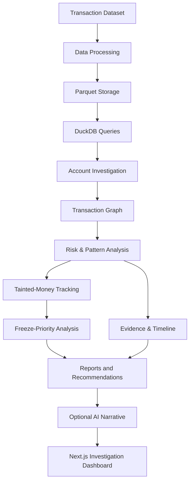

# SANKET — Financial Investigation & Transaction Tracing

**An AI-assisted financial investigation platform designed to trace suspicious money flows, analyze transaction networks, generate explainable risk insights, and help investigators prioritize potential intervention points.**

<p align="center">
  <strong>Trace the Money. Understand the Network. Prioritize the Action.</strong>
</p>

---

## Overview

Financial fraud investigations can involve complex chains of transactions across multiple accounts and banks. Manually tracing these movements can make it difficult to understand where funds travelled, identify suspicious transaction patterns, and determine which accounts deserve further investigation first.

**SANKET** is a financial investigation and decision-support platform developed during **VOID HACKS() 8.0 – ABHEDYA**, a 36-hour offline cybersecurity hackathon.

The system combines transaction data processing, graph analytics, explainable risk signals, evidence generation, and AI-assisted narrative generation into a unified investigation workflow.

Given an account identifier, SANKET helps investigators explore related transactions, understand money movement, examine suspicious patterns, review supporting evidence, and identify potential freeze-priority candidates.

> **Important:** SANKET is a prototype for investigative decision support. Its outputs are analytical indicators, not proof of criminal activity. Freeze recommendations do not execute actual bank freezes, and all findings require human review.

## Key Features

### 🔎 Account Investigation
- Search and investigate an account using its identifier.
- Retrieve related transaction information.
- Explore connected accounts and relevant transaction relationships.
- Present investigation findings through a unified dashboard.

### 🕸️ Transaction Graph Analysis
- Represent accounts as nodes and transactions as directed relationships.
- Visualize relevant transaction connections using Cytoscape.js.
- Explore money movement across multiple levels of connected accounts.
- Focus on the relevant investigation subgraph instead of rendering the entire transaction dataset.

### ⚠️ Explainable Risk Analysis
Analyze transaction patterns such as:
- High fan-in: multiple accounts sending money to one account.
- High fan-out: one account sending money to multiple accounts.
- Rapid pass-through: incoming funds followed by outgoing transfers within a short interval.
- Multi-hop movement through connected accounts.
- Cyclic transaction relationships.
- Cross-bank activity.

Risk signals help explain why an account may require further investigation. A risk score is not a determination of guilt.

### 💸 Tainted-Money Tracking
Trace funds associated with a victim-origin transaction flow through connected accounts.

The taint analysis helps represent how suspicious or victim-origin funds may move through the transaction network. Its results are analytical estimates and depend on the implemented tracing model and available transaction data.

### 🧊 Freeze-Priority Recommendations
Identify potential intervention points in a transaction network and help investigators assess where action may preserve or block more traced funds.

The freeze-planning workflow is intended to support prioritization—not to execute a real bank freeze.

### 🧾 Evidence & Investigation Timeline
- Organize supporting transaction records and risk signals.
- Present the sequence of relevant money movements.
- Help investigators understand why a finding was produced.
- Support review of investigation evidence and related activity.

### 📄 Reports & Notices
Generate investigation reports and support report/notice workflows for further review. Generated documents must be verified by an authorized reviewer before official use.

### 🤖 AI-Assisted Investigation Narrative
SANKET integrates a local Ollama-based AI service for generating investigator-friendly explanations from structured investigation information.

The AI layer is intended to explain findings, not replace the deterministic transaction analysis. Generated narratives may require verification and should never be treated as the source of truth.

### 🛡️ Prompt-Injection Defense
The project includes an AI narrative validation component designed to identify suspicious instructions and unsupported claims in generated output.

This is a prototype security measure and should not be interpreted as a guarantee against every prompt-injection attack or AI hallucination.

### 📊 Benchmark & Judge Mode
The backend provides benchmark and demo endpoints to support project demonstration and evaluation.

---

## System Architecture



The architecture separates data access and investigation logic in the Python backend from the presentation and interaction layer in the frontend.

## Technology Stack

| Technology | Purpose |
|---|---|
| Python | Backend investigation and data-processing logic |
| FastAPI | REST API and backend integration |
| DuckDB | SQL queries over transaction data |
| Polars | Fast tabular data processing |
| Parquet | Columnar data storage |
| PyArrow | Columnar data interoperability |
| NetworkX | Graph and network analysis |
| NumPy & Pandas | Available numerical/data-analysis dependencies; usage depends on the specific module |
| Next.js | Frontend application framework |
| React & TypeScript | User interface and typed frontend components |
| Tailwind CSS | Frontend styling |
| Cytoscape.js | Interactive transaction graph visualization |
| Recharts | Data visualization |
| Ollama | Local AI-assisted narrative generation |
| Pytest | Backend testing framework |

## Investigation Workflow

1. **Account Search** — Enter the account identifier to investigate.
2. **Transaction Retrieval** — Retrieve the relevant transaction records.
3. **Graph Construction** — Build the connected transaction network.
4. **Pattern Detection** — Analyze transaction relationships for suspicious signals.
5. **Risk Analysis** — Present risk indicators and supporting reasons.
6. **Money-Flow Analysis** — Trace victim-origin funds through connected accounts.
7. **Evidence Assembly** — Organize supporting transactions and investigation findings.
8. **Freeze Prioritization** — Identify potential intervention points.
9. **Report Generation** — Prepare investigation outputs for human review.
10. **AI-Assisted Explanation** — Generate a readable narrative where the AI service is available.

The availability and output of individual stages depend on the configured backend, dataset, and enabled services.

## Project Structure

```text
SANKET/
├── backend/
│   ├── api/
│   │   └── routes/
│   │       ├── accounts.py
│   │       ├── investigate.py
│   │       ├── evidence.py
│   │       ├── reports.py
│   │       ├── ai_narrative.py
│   │       └── judge.py
│   ├── db/
│   ├── services/
│   ├── config.py
│   └── main.py
├── data/
│   └── synthetic/
├── docs/
├── frontend/
│   ├── app/
│   ├── components/
│   ├── lib/
│   └── public/
├── scripts/
├── tests/
├── requirements.txt
├── DATA_LAYER.md
├── TECHNICAL.md
└── README.md
```

*Directory contents may evolve as the project develops.*

## Getting Started

### Prerequisites

- Python 3.11 or a compatible version supported by the installed dependencies.
- Node.js and npm.
- Git.
- Ollama with the configured local model, if AI narrative generation is required.

### 1. Clone the repository

```bash
git clone https://github.com/aashnapatle/SANKET.git
cd SANKET
```

### 2. Set up the Python environment

**Windows PowerShell:**

```powershell
python -m venv .venv
.\.venv\Scripts\Activate.ps1
python -m pip install --upgrade pip
pip install -r requirements.txt
```

If PowerShell blocks activation, you may use Command Prompt and activate the environment with:

```bat
.venv\Scripts\activate.bat
```

### 3. Configure the transaction data

The repository includes a synthetic development dataset for testing and demonstration.

Configure the backend to use the expected dataset location and schema before running investigations. A separate hackathon or local transaction dataset may require additional setup.

**Do not present synthetic transactions as real financial evidence.** Real datasets may contain sensitive information and should not be committed to a public repository.

### 4. Start the backend

From the repository root:

```powershell
python -m uvicorn backend.main:app --reload --host 127.0.0.1 --port 8000
```

Backend API documentation:

- API documentation: http://localhost:8000/docs
- Health check: http://localhost:8000/health

### 5. Configure the frontend

Open another terminal:

```powershell
cd frontend
npm install
```

Create or update `frontend/.env.local`:

```env
NEXT_PUBLIC_API_URL=http://localhost:8000
NEXT_PUBLIC_USE_MOCK=false
```

`NEXT_PUBLIC_USE_MOCK=false` configures the frontend to use the backend API rather than its optional mock-data mode.

### 6. Start the frontend

From the `frontend` directory:

```powershell
npm run dev
```

Open the application at:

http://localhost:3000

Keep the backend and frontend terminals running separately.

> **Setup note:** A successful server startup does not guarantee that every investigation feature will work. The configured dataset, schema, dependencies, and optional AI service must also be available.

## API Endpoints

The backend exposes REST endpoints for the investigation workflow.

| Method | Endpoint | Purpose |
|---|---|---|
| GET | `/health` | Check backend availability |
| GET | `/` | Return API information and useful endpoint paths |
| GET | `/api/accounts` | Retrieve account-list data |
| GET | `/api/accounts/{account_id}` | Retrieve account information |
| GET | `/api/transactions/{account_id}` | Retrieve transactions for an account |
| GET | `/api/investigate/{account_id}` | Run an account investigation |
| GET | `/api/graph/{account_id}` | Retrieve the investigation graph |
| GET | `/api/evidence/{account_id}` | Retrieve investigation evidence |
| POST | `/api/reports/{account_id}` | Generate an investigation report |
| POST | `/api/ai/narrative/{account_id}` | Request an AI-assisted narrative |
| GET | `/api/judge/demo` | Retrieve judge/demo information |
| GET | `/api/benchmark` | Retrieve benchmark information |

Some endpoints depend on a valid dataset and a correctly initialized backend. Refer to `/docs` for the API schemas and available parameters.

## Responsible Use & Limitations

SANKET is an experimental investigative decision-support prototype.

- **Risk scores are not proof of crime.**
- **Suspicious patterns require investigation and contextual review.**
- **Tainted-money calculations are analytical estimates, not guaranteed forensic accounting.**
- **Freeze-priority outputs are recommendations, not executed legal or banking actions.**
- **AI-generated narratives may contain errors and require verification.**
- **Prompt-injection validation does not guarantee complete security.**
- **Synthetic data is fabricated for development and must not be presented as real-world evidence.**
- **No official law-enforcement or banking adoption is claimed.**

Use only datasets you are authorized to access. Keep credentials, environment files, private datasets, and personally identifiable financial information out of public commits.

## Team

**Team Anonymous — VOID HACKS() 8.0 – ABHEDYA**

- Aashna Patle
- Ananya Tiwari
- Gunjan Bhangre
- Shreya Patel

## Hackathon Context

Built during the **36-hour offline final round of VOID HACKS() 8.0 – ABHEDYA**, hosted at Shri Vaishnav Vidyapeeth Vishwavidyalaya (SVVV), Indore.

The project explored how transaction analytics, graph-based investigation, explainable risk signals, and AI-assisted reporting can support financial investigation workflows.

## Future Improvements

Potential areas for further development include:

- Stronger dataset-ingestion validation and schema handling.
- Expanded automated tests and reproducible performance benchmarks.
- Improved investigation traceability and evidence export.
- More robust AI-output validation and security testing.
- Clearer deployment configuration and documentation.
- Evaluation against authorized, properly labelled datasets.

These are development opportunities, not claims that the features are already complete.

## License

No license has been specified here. Until a license is added to the repository, reuse and redistribution permissions should not be assumed. Check the hackathon's terms and any third-party code or dataset restrictions before publishing or reusing project material.

---

**SANKET — Supporting better financial investigations through transaction intelligence.**